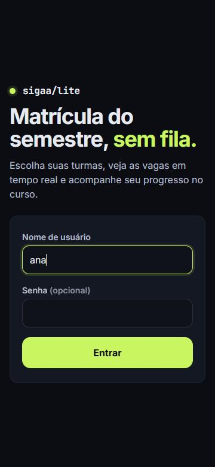
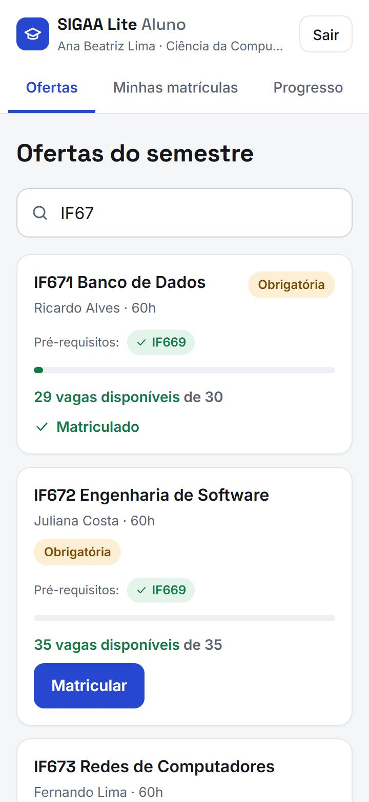
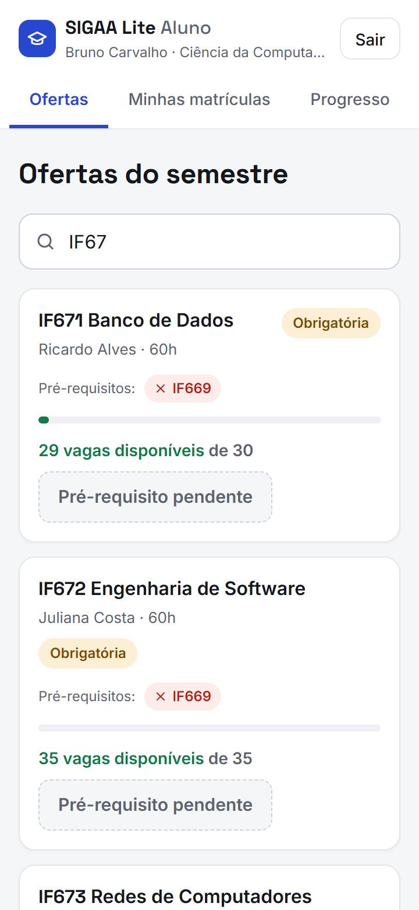
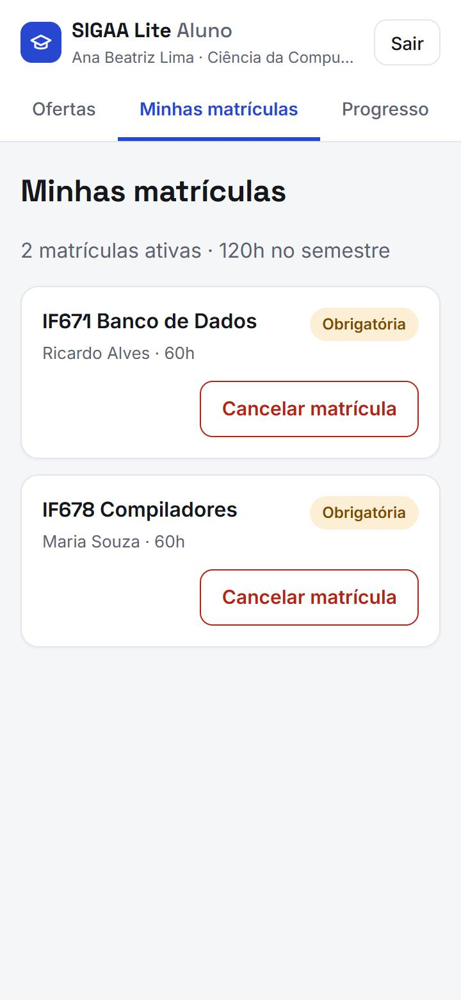
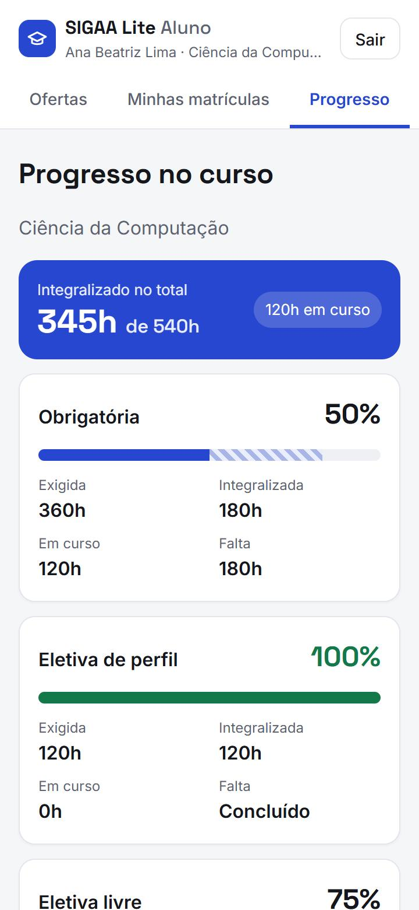
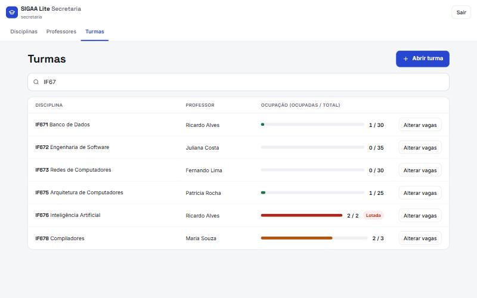
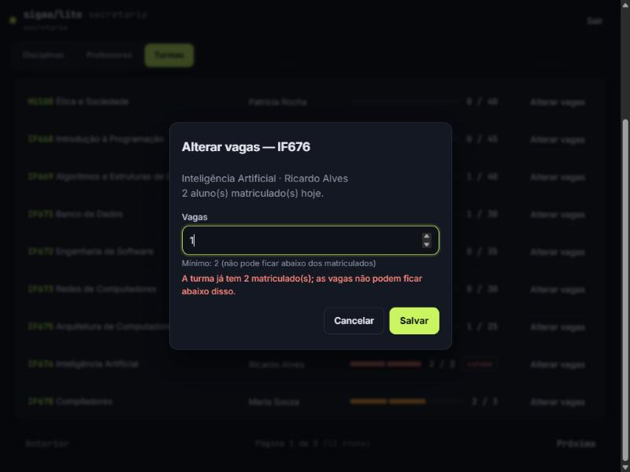
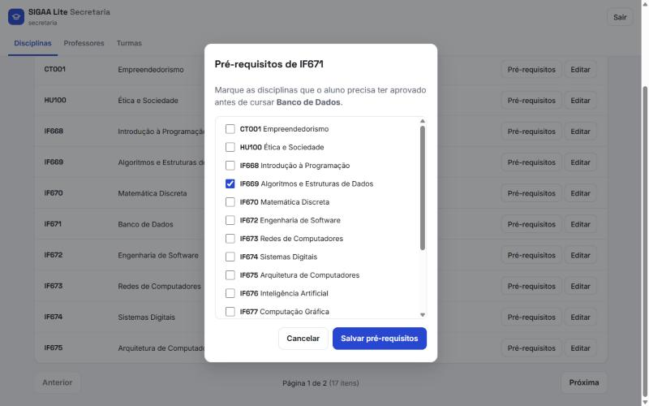

# SIGAA Lite — Sistema de Matrícula

Sistema de matrícula de graduação com dois perfis de acesso — **Secretaria** e **Aluno** — desenvolvido como teste prático da Seleção Nº 5/2026 do CIn-UFPE.

- **Secretaria:** cadastra disciplinas e professores e abre turmas com número de vagas.
- **Aluno:** matricula-se nas turmas do semestre e acompanha quanto falta para concluir o curso.

**O que está entregue:** login por nome de usuário; fluxo completo do aluno (ofertas com classificação por curso, matrícula, cancelamento e progresso), funcionando em celular a partir de 360px; telas da secretaria (disciplinas, professores e turmas); as **13 regras de negócio** com testes automatizados; e o requisito à escolha, **pré-requisitos entre disciplinas**, do back-end ao front-end. São 166 testes no back-end (unitários e de integração com PostgreSQL) e 71 no front-end.

**Atalhos:** [como rodar](#como-rodar-do-zero) · [logins de teste](#como-entrar-logins-de-teste) · [telas](#telas) · [roteiro de demonstração](#roteiro-de-demonstração-passo-a-passo) · [API](#api) · [requisito à escolha](#requisito-à-escolha-pré-requisitos-entre-disciplinas) · [decisões](#principais-decisões) · [rastreabilidade das regras](#rastreabilidade-das-regras-de-negócio) · [o que ficou de fora](#o-que-ficou-de-fora) · [com mais tempo](#o-que-eu-faria-com-mais-tempo)

## Estrutura do repositório (monorepo)

```
sigaa-lite/
├── apps/
│   ├── backend/      # API REST (Express + TypeScript + Prisma)
│   │   └── prisma/   # schema, migrations e seed
│   └── frontend/     # SPA (React + Vite + TypeScript)
├── docker/           # Scripts de inicialização do PostgreSQL
├── docker-compose.yml
├── eslint.config.js  # ESLint compartilhado
├── .prettierrc.json  # Prettier compartilhado
└── tsconfig.base.json
```

Os dois apps são **npm workspaces**: um único `npm install` na raiz instala tudo, e as configurações de TypeScript, ESLint e Prettier são compartilhadas.

## Pré-requisitos

- [Node.js](https://nodejs.org/) 22.12 ou superior (npm incluso) — testado com Node 22 e 24
- [Docker](https://www.docker.com/) com Docker Compose (para o PostgreSQL)

## Como rodar do zero

```bash
# 1. Instalar as dependências de todos os workspaces
npm install

# 2. Criar os arquivos de ambiente
cp apps/backend/.env.example apps/backend/.env
cp apps/frontend/.env.example apps/frontend/.env

# 3. Subir o banco de dados
docker compose up -d

# 4. Criar as tabelas (migrations) e carregar os dados iniciais (seed)
npm run db:migrate
npm run db:seed

# 5. Rodar back-end (http://localhost:3333) e front-end (http://localhost:5173)
npm run dev
```

Depois, abra **http://localhost:5173** e entre com um dos [logins de teste](#como-entrar-logins-de-teste) (ex.: `ana` ou `secretaria`). Para rodar os testes: `npm test` (com o banco no ar).

> No PowerShell, use `Copy-Item` no lugar de `cp`.
>
> O `npm install` já gera o Prisma Client (`postinstall`). Para recomeçar do zero a qualquer momento: `npm run db:reset` (apaga o banco, reaplica as migrations e roda o seed).

Este passo a passo foi validado clonando o repositório numa pasta limpa, com um banco novo, e seguindo exatamente os comandos acima.

**Se algo der errado:**

- _Porta 5432 ocupada_ (outro PostgreSQL na máquina): troque o mapeamento em `docker-compose.yml` (ex.: `'5433:5432'`) e a porta em `DATABASE_URL` e `TEST_DATABASE_URL` no `apps/backend/.env`.
- _"Não foi possível falar com o servidor" na tela de login_: a API não está no ar ou o front aponta para outro endereço (`VITE_API_URL` em `apps/frontend/.env`).
- _Testes de integração falhando ao conectar_: o PostgreSQL precisa estar rodando (`docker compose up -d`); o banco de testes `sigaa_test` é criado pelo próprio compose.

## Como entrar (logins de teste)

O login é feito **só pelo nome de usuário**. A senha é opcional no sistema e **nenhum usuário do seed tem senha**: deixe o campo em branco.



1. Abra **http://localhost:5173**.
2. Em **Nome de usuário**, digite um dos logins da tabela (ex.: `ana`).
3. Deixe **Senha** em branco e clique em **Entrar**.
4. Você vai direto para a área do seu perfil: **Ofertas** (aluno) ou **Disciplinas** (secretaria).
5. Para trocar de usuário, clique em **Sair**, no canto superior direito.

Um aluno que tenta abrir uma página da secretaria (ou o contrário) vê "Acesso negado". Se a sessão expirar (1 hora), o sistema volta para o login com um aviso.

<br clear="right">

| Login        | Senha   | Perfil     | Curso                    | O que esse usuário mostra                                                                                                                                 |
| ------------ | ------- | ---------- | ------------------------ | --------------------------------------------------------------------------------------------------------------------------------------------------------- |
| `secretaria` | (vazia) | Secretaria | —                        | Cadastros de disciplinas, professores e turmas                                                                                                            |
| `ana`        | (vazia) | Aluno      | Ciência da Computação    | 165h de eletiva de perfil (exige 120h): **45h excedentes contam como livre**                                                                              |
| `bruno`      | (vazia) | Aluno      | Ciência da Computação    | Recursa IF669 (reprovado); ocupa uma das 2 vagas da turma lotada de IF676; **sem IF669 aprovada, não pode cursar IF671, IF672 nem IF678 (pré-requisito)** |
| `carla`      | (vazia) | Aluno      | Engenharia da Computação | Mesmas disciplinas da Ana com outra classificação (IF671 é perfil, IF677 é livre)                                                                         |
| `diego`      | (vazia) | Aluno      | Engenharia da Computação | Calouro sem histórico (progresso zerado); **não pode cursar IF669 sem antes ser aprovado em IF668**                                                       |
| `eduarda`    | (vazia) | Aluno      | Engenharia da Computação | Quase formada: obrigatórias e perfil completas, livre acima do exigido (limite de 100%)                                                                   |

> Para voltar os dados ao estado inicial depois de testar (ex.: desfazer matrículas feitas): `npm run db:seed`.

### Dados de exemplo

- **Cursos:** Ciência da Computação (CC) e Engenharia da Computação (EC), ambos exigindo 360h obrigatórias, 120h de eletiva de perfil e 60h de eletiva livre.
- **Disciplinas compartilhadas com classificação diferente:** IF671 e IF672 são obrigatórias em CC e eletivas de perfil em EC; IF673 é eletiva de perfil em CC e obrigatória em EC; IF677 e IF678 estão só em CC, e IF674 só em EC (eletiva livre para o outro curso).
- **Fora das duas estruturas (sempre eletiva livre):** CT001, LE500 e HU100.
- **Turmas:** 12 turmas no semestre; **IF676 está lotada** (2/2) e **IF678 tem uma única vaga** (2/3).

## Telas

Capturas do sistema rodando com os dados do seed. As telas do aluno são mostradas em celular (360px de largura, o mínimo exigido); as da secretaria, em desktop.

### Aluno

<table>
  <tr>
    <td align="center" width="33%"><br><b>Ofertas</b><br><sub>Anéis com o progresso por grupo no topo; em cada turma, classificação para o curso do aluno, pré-requisitos, ocupação e vagas. Busca e página ficam na URL.</sub></td>
    <td align="center" width="33%"><br><b>Confirmar matrícula</b><br><sub>Resumo da turma e como a CH vai contar no progresso, com anéis "hoje → com esta matrícula" (aqui, perfil completo → as 60h completam a eletiva livre).</sub></td>
    <td align="center" width="33%"><br><b>Pré-requisito pendente</b><br><sub>Login <code>bruno</code>: sem IF669 aprovada, o botão fica bloqueado (requisito à escolha).</sub></td>
  </tr>
  <tr>
    <td align="center"><br><b>Minhas matrículas</b><br><sub>Só as matrículas ativas do próprio aluno; cancelar pede confirmação e devolve a vaga.</sub></td>
    <td align="center"><br><b>Progresso</b><br><sub>CH exigida, integralizada, em curso (listrada) e o que falta, por grupo.</sub></td>
    <td align="center"><br><b>Login</b><br><sub>Só o nome de usuário; a senha é opcional.</sub></td>
  </tr>
</table>

### Secretaria

<p align="center">
  <br>
  <b>Turmas</b> — ocupação de cada turma (ocupadas / total), com a turma lotada destacada.
</p>

<table>
  <tr>
    <td align="center" width="50%"><br><b>Regra 5</b><br><sub>Tentar deixar a IF676 com 1 vaga, tendo 2 matriculados, é recusado com a explicação no próprio campo.</sub></td>
    <td align="center" width="50%"><br><b>Pré-requisitos</b><br><sub>A secretaria marca o que precisa estar aprovado antes; ciclos são recusados.</sub></td>
  </tr>
</table>

## Roteiro de demonstração (passo a passo)

Com o sistema rodando e os dados do seed, este roteiro passa por todas as regras em poucos minutos.

**Como aluno**

1. Entre como **`ana`**. Na aba **Ofertas**, busque `IF67`: cada turma mostra a classificação **para Ciência da Computação**, os pré-requisitos (✓ aprovado) e a ocupação. IF671 e IF678 já aparecem como "Matriculado".
2. Clique em **Matricular** na **IF673**. Abre a **confirmação**: como a Ana já completou as 120h de eletiva de perfil, ela avisa que estas 60h vão contar como **eletiva livre** (regra 11). Confirme.
3. Abra **Minhas matrículas**: a IF673 aparece na lista. Clique em **Cancelar matrícula**, confirme, e veja a vaga voltar nas ofertas (regra 8).
4. Abra **Progresso**: eletiva de perfil em 100% e as 45h excedentes contando em eletiva livre; a CH das matrículas aparece separada, como "em curso" (regras 11 e 12).
5. Clique em **Sair** e entre como **`carla`** (Engenharia): as **mesmas disciplinas** aparecem com outra classificação — IF671 é eletiva de perfil, IF677 é livre (regra 10). Tente a **IF676**: **turma lotada** (regra 6).
6. Entre como **`bruno`**: IF671, IF672 e IF678 mostram **✗ IF669** e o botão "Pré-requisito pendente" (requisito à escolha). Tente a **IF668**: ele já foi aprovado, então ela aparece como "Já aprovado" (regra 7).
7. Entre como **`eduarda`**: em **Progresso**, eletiva livre tem 105h de 60h, mas o percentual para em **100%** e "Falta" mostra "Concluído" (regra 13).

**Como secretaria**

1. Entre como **`secretaria`**. Em **Disciplinas**, clique em **Nova disciplina** e tente **CH 20** (recusada: precisa ser múltipla de 15 entre 15 e 120) e depois o código **IF668** (recusado: já existe) — regras 1 e 2.
2. Em **Professores**, tente cadastrar o e-mail `maria.souza@exemplo.edu.br` (recusado: já existe) — regra 3.
3. Em **Turmas**, clique em **Abrir turma**: é preciso escolher disciplina e professor e ter pelo menos 1 vaga (regra 4). Depois, em **Alterar vagas** da **IF676**, tente **1** vaga: recusado, porque há 2 matriculados (regra 5).
4. Em **Disciplinas → Pré-requisitos** da **IF668**, marque a **IF671** e salve: recusado, porque criaria um ciclo (IF671 → IF669 → IF668).
5. Saia e tente abrir `http://localhost:5173/aluno/ofertas` sem login: o sistema leva para o login. Entre como aluno e abra `http://localhost:5173/secretaria/turmas`: "Acesso negado".

> Ao terminar, `npm run db:seed` volta os dados ao estado inicial.

## Modelo de dados

```
Usuario 1──0..1 Aluno N──1 Curso 1──N EstruturaCurricular N──1 Disciplina
                  │                                                 │
                  ├──N HistoricoItem N──────────────────────────────┤
                  │                                                 │
                  └──N Matricula N──1 Turma N──1 Professor          │
                                        └──────N──1─────────────────┤
                                                                    │
                      PreRequisito (disciplina exige disciplina) N──┘
```

| Entidade              | Restrições principais                                                                     |
| --------------------- | ----------------------------------------------------------------------------------------- |
| `Usuario`             | `username` único; perfil `SECRETARIA` ou `ALUNO`; senha opcional                          |
| `Curso`               | CH mínima por grupo (obrigatória, eletiva de perfil, eletiva livre), nunca negativa       |
| `Disciplina`          | `codigo` único (regra 1); CH múltipla de 15 entre 15 e 120 (regra 2)                      |
| `EstruturaCurricular` | Chave primária `(curso, disciplina)`; tipo `OBRIGATORIA` ou `ELETIVA_PERFIL`              |
| `Professor`           | `email` único (regra 3)                                                                   |
| `Turma`               | Disciplina e professor obrigatórios; `vagas >= 1` (regra 4)                               |
| `Aluno`               | Pertence a um curso e a um usuário                                                        |
| `Matricula`           | Situação `ATIVA` ou `CANCELADA`; **no máximo uma matrícula ativa por (aluno, turma)**     |
| `HistoricoItem`       | Situação `APROVADO` ou `REPROVADO`, com semestre; único por (aluno, disciplina, semestre) |
| `PreRequisito`        | Chave primária `(disciplina, pré-requisito)`; a disciplina não pode exigir a si mesma     |

## Scripts de banco (na raiz)

| Comando              | O que faz                                                           |
| -------------------- | ------------------------------------------------------------------- |
| `npm run db:migrate` | Aplica as migrations pendentes (`prisma migrate deploy`)            |
| `npm run db:seed`    | Apaga os dados e recarrega o seed (pode ser executado várias vezes) |
| `npm run db:reset`   | Recria o banco do zero: migrations + seed                           |

## Scripts úteis (na raiz)

| Comando                | O que faz                                           |
| ---------------------- | --------------------------------------------------- |
| `npm run dev`          | Sobe back-end e front-end juntos                    |
| `npm run dev:backend`  | Sobe só a API, com recarregamento automático        |
| `npm run dev:frontend` | Sobe só o front-end                                 |
| `npm test`             | Roda todos os testes (back-end e front-end)         |
| `npm run test:unit`    | Roda só os testes unitários do back-end (sem banco) |
| `npm run lint`         | Analisa o código com ESLint                         |
| `npm run format`       | Formata o código com Prettier                       |
| `npm run typecheck`    | Verifica os tipos de todos os workspaces            |
| `npm run build`        | Gera o build de produção dos dois apps              |

> Os testes de integração usam o banco `sigaa_test` (criado pelo docker-compose), então o PostgreSQL precisa estar no ar: `docker compose up -d`. As migrations são aplicadas automaticamente nesse banco antes dos testes, e ele é limpo antes de cada teste — o banco de desenvolvimento nunca é tocado.

## API

Base: `http://localhost:3333`. Rotas autenticadas exigem o cabeçalho `Authorization: Bearer <token>`.

### Autenticação

| Método | Rota          | Body                                  | Resposta                              | Erros                                                   |
| ------ | ------------- | ------------------------------------- | ------------------------------------- | ------------------------------------------------------- |
| POST   | `/auth/login` | `{ "username": "ana", "senha"?: "" }` | `200 { token, expiresIn, usuario }`   | 400 `VALIDACAO`, 401 `CREDENCIAIS_INVALIDAS`            |
| GET    | `/auth/me`    | —                                     | `200 { id, username, perfil, aluno }` | 401 `TOKEN_AUSENTE`, `TOKEN_INVALIDO`, `TOKEN_EXPIRADO` |

`usuario.aluno` é `{ id, nome, curso: { id, nome } }` para alunos e `null` para a secretaria.

### Aluno

Todas exigem token de um usuário com perfil `ALUNO` (401 sem token, 403 com outro perfil). **O aluno é sempre o do token**: nenhuma rota recebe o id do aluno.

| Método | Rota                    | Entrada               | Resposta                                                   | Erros de negócio                                                                                                                                |
| ------ | ----------------------- | --------------------- | ---------------------------------------------------------- | ----------------------------------------------------------------------------------------------------------------------------------------------- |
| GET    | `/aluno/ofertas`        | `?q=&page=&pageSize=` | `200` página de ofertas (abaixo)                           | —                                                                                                                                               |
| POST   | `/aluno/matriculas`     | `{ "turmaId": 1 }`    | `201 { id }`                                               | 404 `TURMA_NAO_ENCONTRADA`, 422 `TURMA_LOTADA`, 422 `DISCIPLINA_JA_APROVADA`, 409 `JA_MATRICULADO_NA_TURMA`, 422 `JA_MATRICULADO_NA_DISCIPLINA` |
| GET    | `/aluno/matriculas`     | —                     | `200 [{ id, criadaEm, turma, classificacao }]` (só ativas) | —                                                                                                                                               |
| DELETE | `/aluno/matriculas/:id` | —                     | `204`                                                      | 404 `MATRICULA_NAO_ENCONTRADA`, 422 `MATRICULA_JA_CANCELADA`                                                                                    |
| GET    | `/aluno/progresso`      | —                     | `200 { curso, grupos }`                                    | —                                                                                                                                               |

Cada **oferta** traz:

```json
{
  "id": 7,
  "disciplina": { "id": 9, "codigo": "IF676", "nome": "Inteligência Artificial", "ch": 60 },
  "professor": { "id": 2, "nome": "Ricardo Alves" },
  "vagas": 2,
  "vagasOcupadas": 2,
  "vagasDisponiveis": 0,
  "lotada": true,
  "classificacao": "ELETIVA_PERFIL",
  "matriculaId": null,
  "jaAprovado": false,
  "preRequisitos": []
}
```

`classificacao` é `OBRIGATORIA`, `ELETIVA_PERFIL` ou `ELETIVA_LIVRE` **para o curso do aluno logado**; `matriculaId` é a matrícula ativa do aluno nessa turma (ou `null`); `jaAprovado` indica que ele não pode se matricular. `preRequisitos` lista os pré-requisitos da disciplina com `atendido` (aprovado no histórico) — ex.: `[{ "id": 2, "codigo": "IF669", "nome": "Algoritmos…", "atendido": false }]`.

A matrícula também pode ser recusada com `422 PRE_REQUISITO_PENDENTE`, com `details.pendentes` listando o que falta.

Cada **grupo** do progresso traz:

```json
{
  "grupo": "ELETIVA_PERFIL",
  "chExigida": 120,
  "chIntegralizada": 120,
  "chEmCurso": 0,
  "chFaltante": 0,
  "percentual": 100
}
```

### Secretaria

Todas exigem token de um usuário com perfil `SECRETARIA` (401 sem token, 403 com outro perfil). Listagens aceitam `?q=&page=&pageSize=`. Toda disciplina devolvida pela API traz também `preRequisitos: [{ id, codigo, nome }]`.

| Método | Rota                                         | Entrada                                           | Resposta                                                                                | Erros                                                                                                    |
| ------ | -------------------------------------------- | ------------------------------------------------- | --------------------------------------------------------------------------------------- | -------------------------------------------------------------------------------------------------------- |
| GET    | `/secretaria/disciplinas`                    | busca por código ou nome                          | `200` página de `{ id, codigo, nome, ch }`                                              | —                                                                                                        |
| POST   | `/secretaria/disciplinas`                    | `{ codigo, nome, ch }`                            | `201 { id, codigo, nome, ch }`                                                          | 400 `VALIDACAO` (CH inválida etc.), 409 `CODIGO_DUPLICADO`                                               |
| GET    | `/secretaria/disciplinas/:id`                | —                                                 | `200 { id, codigo, nome, ch }`                                                          | 404 `DISCIPLINA_NAO_ENCONTRADA`                                                                          |
| PUT    | `/secretaria/disciplinas/:id`                | `{ codigo, nome, ch }`                            | `200 { id, codigo, nome, ch }`                                                          | 400, 404, 409 `CODIGO_DUPLICADO`                                                                         |
| PUT    | `/secretaria/disciplinas/:id/pre-requisitos` | `{ preRequisitoIds: [1, 2] }` (substitui a lista) | `200` disciplina com `preRequisitos`                                                    | 400, 404, 422 `PRE_REQUISITO_INVALIDO` (a própria), `PRE_REQUISITO_INEXISTENTE`, `PRE_REQUISITO_CICLICO` |
| GET    | `/secretaria/professores`                    | busca por nome ou e-mail                          | `200` página de `{ id, nome, email }`                                                   | —                                                                                                        |
| POST   | `/secretaria/professores`                    | `{ nome, email }`                                 | `201 { id, nome, email }`                                                               | 400 (e-mail inválido), 409 `EMAIL_DUPLICADO`                                                             |
| GET    | `/secretaria/turmas`                         | busca por disciplina ou professor                 | `200` página de `{ id, disciplina, professor, vagas, vagasOcupadas, vagasDisponiveis }` | —                                                                                                        |
| POST   | `/secretaria/turmas`                         | `{ disciplinaId, professorId, vagas }`            | `201 { id }`                                                                            | 400 (vagas < 1, campo faltando), 422 `DISCIPLINA_INEXISTENTE` / `PROFESSOR_INEXISTENTE`                  |
| PATCH  | `/secretaria/turmas/:id/vagas`               | `{ vagas }`                                       | `200 { id, vagas, vagasOcupadas }`                                                      | 400, 404 `TURMA_NAO_ENCONTRADA`, 422 `VAGAS_ABAIXO_DOS_MATRICULADOS` (`details: { matriculados }`)       |

O código da disciplina é normalizado (sem espaços, em maiúsculas: `if 668` → `IF668`) e o e-mail do professor em minúsculas, então a unicidade não depende de maiúsculas.

### Formato de erro

Todos os erros têm o mesmo formato. O `code` é estável e pode ser usado pelo front-end; a `message` é legível para o usuário; `details` aparece só quando ajuda (ex.: campos inválidos).

```json
{
  "code": "VALIDACAO",
  "message": "Dados de entrada inválidos.",
  "details": [{ "campo": "username", "mensagem": "Informe o nome de usuário" }]
}
```

| Status | Quando                                                    | Exemplos de `code`                                                        |
| ------ | --------------------------------------------------------- | ------------------------------------------------------------------------- |
| 400    | Entrada mal formada (tipo, formato, campo faltando, JSON) | `VALIDACAO`, `JSON_INVALIDO`                                              |
| 401    | Não autenticado                                           | `TOKEN_AUSENTE`, `TOKEN_EXPIRADO`, `CREDENCIAIS_INVALIDAS`                |
| 403    | Autenticado, mas com perfil sem acesso                    | `ACESSO_NEGADO`                                                           |
| 404    | Recurso ou rota inexistente                               | `ROTA_NAO_ENCONTRADA`, `TURMA_NAO_ENCONTRADA`                             |
| 409    | Conflito com dados existentes (duplicidade)               | `CODIGO_DUPLICADO`, `EMAIL_DUPLICADO`, `JA_MATRICULADO_NA_TURMA`          |
| 422    | Entrada válida, mas recusada por regra de negócio         | `TURMA_LOTADA`, `DISCIPLINA_JA_APROVADA`, `VAGAS_ABAIXO_DOS_MATRICULADOS` |
| 500    | Erro inesperado (sem detalhes internos na resposta)       | `ERRO_INTERNO`                                                            |

### Listagens: busca e paginação

Todas as listagens aceitam `?q=<busca>&page=<n>&pageSize=<n>` (padrão `page=1`, `pageSize=10`, máximo `50`) e respondem:

```json
{ "items": [], "total": 0, "page": 1, "pageSize": 10, "totalPages": 0 }
```

## Requisito à escolha: pré-requisitos entre disciplinas

### Por que este

Pré-requisitos são uma regra central de qualquer matrícula real e se apoiam no que o sistema já tem: o **histórico de aprovações** (o mesmo usado na regra 7) e o fluxo de matrícula com transação. Isso permite entregar o requisito completo — modelagem, regra, testes, seed e telas do aluno e da secretaria — sem aumentar muito a complexidade, seguindo a orientação do edital de preferir poucas coisas bem feitas. Choque de horário e lista de espera ficaram em "o que eu faria com mais tempo".

### Regras definidas

1. Uma disciplina pode ter **zero ou mais pré-requisitos**, que são outras disciplinas.
2. O aluno só pode se matricular numa turma se tiver **aprovação no histórico em todos os pré-requisitos** da disciplina.
3. **Reprovação não atende** o pré-requisito, e **matrícula em curso também não**: não é possível cursar a disciplina e o seu pré-requisito no mesmo semestre.
4. A recusa é `422 PRE_REQUISITO_PENDENTE`, com a lista dos pré-requisitos que faltam em `details.pendentes` (código e nome), para a tela dizer exatamente o que falta.
5. A verificação acontece **na mesma transação da matrícula**, depois de "turma existe", "já aprovado" e "já matriculado", e antes de "turma lotada": quem não tem o pré-requisito fica sabendo disso, e não que a turma está cheia.
6. Nas **ofertas**, cada turma mostra os pré-requisitos da disciplina e se cada um está atendido; com algum pendente, o botão de matrícula aparece desabilitado como "Pré-requisito pendente". Como sempre, quem decide é a API.
7. A **secretaria define** os pré-requisitos de cada disciplina, substituindo a lista inteira de uma vez.
8. Uma disciplina **não pode ser pré-requisito de si mesma**, e não são permitidos **ciclos** (A exige B e B exige A, direta ou indiretamente), porque ninguém conseguiria cursar nenhuma das duas. Ambos recusados com `422`.
9. Alterar pré-requisitos **não afeta matrículas já feitas**: vale para as próximas matrículas.

### Como foi implementado

- **Modelo**: tabela `pre_requisitos (disciplina_id, pre_requisito_id)` com chave composta e um `CHECK` que impede a disciplina de exigir a si mesma ([migration](apps/backend/prisma/migrations/20261123003055_pre_requisitos/migration.sql)).
- **Matrícula** ([`aluno.service.ts`](apps/backend/src/modules/aluno/aluno.service.ts)): dentro da transação já existente, uma consulta busca os pré-requisitos sem aprovação no histórico do aluno; se houver algum, recusa com `PRE_REQUISITO_PENDENTE`.
- **Ciclos** ([`pre-requisitos.ts`](apps/backend/src/modules/secretaria/pre-requisitos.ts)): função pura que faz uma busca em profundidade a partir dos novos pré-requisitos; há ciclo se der para voltar à própria disciplina. Testada isoladamente (ciclo direto, indireto, cadeia, losango).
- **Concorrência na secretaria**: a troca de pré-requisitos roda numa transação que trava a tabela `pre_requisitos` contra escrita (`LOCK TABLE ... IN SHARE ROW EXCLUSIVE MODE`). Sem isso, duas edições simultâneas (A exige B / B exige A) poderiam passar cada uma pela checagem de ciclo sem enxergar a outra. Leituras (ofertas, matrículas) não são bloqueadas.
- **Telas**: nas ofertas, cada pré-requisito aparece como aprovado (✓) ou pendente (✗), com texto para leitores de tela, e o botão vira "Pré-requisito pendente"; na secretaria, a tabela mostra os pré-requisitos e uma janela permite marcá-los (a própria disciplina não aparece como opção).
- **Seed**: IF669 exige IF668; IF671, IF672 e IF678 exigem IF669; IF675 exige IF674; IF680 exige IF674 e IF675. Todas as matrículas do seed respeitam os pré-requisitos.
- **Testes**: unitários do service (pendente, reprovação, matrícula em curso, prioridade sobre "lotada", status nas ofertas) e da detecção de ciclos; integração pela API (matrícula, ofertas, definição, substituição, ciclos, inexistentes, permissão); e telas do aluno e da secretaria. Verificado por mutação: remover a checagem na matrícula ou a de ciclos faz testes falharem.

## Principais decisões

### Back-end: Express

Escolhi o **Express** por ser minimalista e amplamente conhecido: a organização do código (rotas → controllers → services → repositórios) fica explícita no próprio projeto, em vez de escondida em convenções do framework. Isso deixa cada decisão visível e fácil de explicar. NestJS traria injeção de dependência e decorators que seriam complexidade desnecessária para o tamanho deste sistema.

A aplicação é criada por uma função (`createApp`) separada do `server.ts`, o que permite testar as rotas com **supertest** sem abrir uma porta.

### Organização do código

```
apps/backend/src/
├── app.ts               # raiz de composição: cria repositórios, services e rotas
├── server.ts            # sobe o servidor HTTP
├── config/env.ts        # variáveis de ambiente validadas
├── database/prisma.ts   # client do Prisma
├── modules/<domínio>/   # um módulo por domínio (auth, aluno, secretaria...)
│   ├── *.routes.ts      # rotas e middlewares de acesso
│   ├── *.controller.ts  # HTTP ⇄ service: valida a entrada e devolve a resposta
│   ├── *.service.ts     # regras de negócio
│   ├── *.repository.ts  # consultas ao banco
│   └── *.schemas.ts     # schemas Zod da entrada
└── shared/              # erros, validação, paginação, autenticação
```

As **regras de negócio ficam nos services**, nunca nos controllers. Os services recebem as dependências por parâmetro (funções fábrica `createXxx`), sem framework de injeção de dependência: em teste, basta passar outras implementações.

### Autenticação: JWT sem estado

O login é por nome de usuário (a senha é opcional, como pede o enunciado). A API devolve um **JWT assinado com HS256** e validade curta (1h por padrão, configurável em `JWT_EXPIRES_IN_SECONDS`) contendo o id do usuário, o perfil e, para alunos, o id do aluno.

- O token vai no cabeçalho `Authorization` (não em cookie), o que evita CSRF. Sem sessão no servidor, a API continua sem estado.
- **O aluno é sempre identificado pelo token**, nunca pelo corpo nem pela URL (regra 9). Não existe rota que receba o id do aluno.
- Se um usuário tiver senha cadastrada, ela é exigida e verificada com **scrypt** (nativo do Node). Os usuários do seed não têm senha.
- Usuário inexistente e senha errada recebem a **mesma resposta**, para não revelar quais usuários existem.
- Guards: `authenticate` (401) e `requirePerfil('ALUNO' | 'SECRETARIA')` (403).

### Códigos HTTP

Separei **400** (a requisição está mal formada) de **422** (a requisição é válida, mas uma regra de negócio a recusa, como turma lotada). Assim o front-end sabe se o problema é no formulário ou na situação. Conflitos de unicidade (código de disciplina ou e-mail repetido) usam **409**.

### Segurança

- CORS restrito à origem do front-end (`CORS_ORIGIN`);
- cabeçalhos de segurança com `helmet`;
- segredos apenas no `.env` (fora do git); a API não sobe sem um `JWT_SECRET` de pelo menos 32 caracteres;
- consultas via Prisma (parametrizadas), sem SQL concatenado;
- corpo das requisições limitado a 100 kB e `pageSize` limitado a 50;
- erros inesperados não expõem detalhes internos.

### Banco de dados: PostgreSQL

O **PostgreSQL** oferece transações e locks de linha (`SELECT ... FOR UPDATE`), necessários para tratar com segurança a concorrência na última vaga de uma turma. Ele roda via Docker Compose, então não é preciso instalar nada além do Docker. Um segundo banco (`sigaa_test`) é criado automaticamente para os testes de integração, isolado dos dados de desenvolvimento.

### ORM: Prisma

O **Prisma** gera tipos TypeScript a partir do schema e mantém o histórico de migrations versionado. Uso o driver `pg` via adapter oficial (`@prisma/adapter-pg`), padrão do Prisma 7.

**Regras de integridade no banco, não só na API.** Algumas restrições não podem ser expressas no `schema.prisma`, então foram escritas em SQL na migration inicial:

- `CHECK` da CH da disciplina (múltipla de 15, entre 15 e 120) e de `vagas >= 1`;
- **índice único parcial** `(aluno_id, turma_id) WHERE situacao = 'ATIVA'`: impede matrícula duplicada mesmo sob concorrência, mas permite que o aluno se matricule de novo numa turma da qual tinha cancelado;
- `CHECK` que amarra `cancelada_em` à situação `CANCELADA`.

A API também valida tudo isso e devolve erros de negócio claros; o banco é a última linha de defesa.

**Vagas ocupadas = contagem de matrículas ativas**, sem um contador na tabela de turmas. Assim não existe um número que possa ficar dessincronizado: cancelar uma matrícula devolve a vaga automaticamente (regra 8). A concorrência na última vaga é tratada na matrícula (abaixo).

**Matrículas canceladas não são apagadas**: ficam com situação `CANCELADA` e data de cancelamento, preservando o histórico.

**IDs inteiros autoincrementais**, mais simples de ler e depurar. Como o aluno é sempre identificado pelo token (nunca pela URL ou corpo), um id sequencial não permite acessar dados de outro aluno.

### Matrícula e concorrência na última vaga

Toda a matrícula acontece **numa transação que começa travando a linha da turma** (`SELECT ... FOR UPDATE`). Se dois alunos tentam a última vaga ao mesmo tempo, o segundo espera o primeiro terminar e, ao contar as matrículas ativas, já enxerga a vaga ocupada — e recebe `TURMA_LOTADA`.

Como isso é testado: disparar requisições simultâneas raramente acerta a janela exata da corrida, então um teste assim passaria mesmo sem o lock (verifiquei). Por isso há um **teste determinístico**: o próprio teste abre uma transação que trava a turma e ocupa a última vaga sem confirmar; a matrícula pela API precisa esperar e, depois, receber `TURMA_LOTADA`. Removendo o `FOR UPDATE`, esse teste falha (a API aceita a matrícula). Há também um teste com 6 matrículas simultâneas numa turma de 1 vaga como verificação ponta a ponta.

Escolhi o lock de linha em vez de um contador com update condicional porque as vagas são **calculadas** (contagem de matrículas ativas), então não há uma coluna para atualizar condicionalmente. O lock é só da turma em questão: matrículas em turmas diferentes não se bloqueiam.

Ordem das verificações, dentro da transação: turma existe (404) → disciplina já aprovada (422) → já matriculado nesta turma (409) ou em outra turma da mesma disciplina (422) → pré-requisito pendente (422) → turma lotada (422). Assim, quem já está matriculado numa turma lotada recebe a mensagem certa ("já matriculado"), e quem não tem o pré-requisito fica sabendo disso, e não que a turma está cheia.

Decisões:

- **Reprovado pode, aprovado não** (regra 7): só um item `APROVADO` no histórico bloqueia a matrícula.
- **Não permito duas turmas da mesma disciplina ao mesmo tempo**: não faz sentido cursar a mesma disciplina duas vezes no semestre, e isso contaria a CH em dobro no progresso.
- **Já matriculado na turma responde 409** (conflito: o recurso já existe); as demais recusas são **422** (regra de negócio).
- **Cancelar = `DELETE /aluno/matriculas/:id` → 204.** Para o aluno, a matrícula deixa de existir entre as ativas; no banco ela vira `CANCELADA` com a data, e a vaga volta automaticamente porque só as ativas são contadas (regra 8). O cancelamento é um update condicional (`WHERE situacao = 'ATIVA'`), então dois cancelamentos simultâneos não "devolvem" a vaga duas vezes.
- **Matrícula de outro aluno responde 404**, igual a uma inexistente, em vez de 403: assim a API não revela que aquele id existe (regra 9). A busca já é filtrada pelo aluno do token.
- `GET /aluno/matriculas` **não é paginada**: um aluno tem poucas matrículas no semestre.

### Progresso: função pura

O cálculo fica em [`progresso.ts`](apps/backend/src/modules/aluno/progresso.ts), uma **função pura** que recebe a CH exigida do curso, a estrutura curricular, as disciplinas aprovadas e as em curso. Sem banco e sem efeitos colaterais, as regras 10 a 13 são testadas diretamente, com casos pequenos e legíveis.

- **Classificação** (regra 10): pela estrutura do curso do aluno; fora da estrutura é eletiva livre.
- **Só aprovadas integralizam** (regra 12); matrículas ativas aparecem em `chEmCurso` e **não reduzem** `chFaltante`, que é o que ainda precisa ser aprovado.
- **Excedente de perfil vira livre** (regra 11). Decidi aplicar o mesmo à CH em curso: se o aluno já integralizou 90h de 120h de perfil e está cursando 60h de perfil, 30h aparecem como perfil em curso e 30h como livre em curso — que é como elas vão contar quando forem aprovadas.
- **Limites** (regra 13): `chFaltante = max(0, exigida − integralizada)` e `percentual = min(100, ⌊integralizada / exigida × 100⌋)`. `chIntegralizada` mostra o valor real (pode passar do exigido); só o percentual é limitado. Arredondo **para baixo** para não exibir 100% antes de o grupo estar completo.
- Uma disciplina aprovada mais de uma vez no histórico conta uma vez só.

### Validação: Zod

O **Zod** valida as variáveis de ambiente (a API não sobe se algo estiver errado) e a entrada de todas as rotas (body e query string), gerando os tipos TypeScript a partir dos próprios schemas. A validação é centralizada na função `parse`, que transforma qualquer falha em `400 VALIDACAO` com a lista de campos.

### Testes: Vitest + supertest

O **Vitest** é rápido, tem suporte nativo a TypeScript/ESM e API compatível com Jest. Os testes são divididos em dois projetos:

- **unit** (`tests/unit`): funções puras e peças isoladas, sem banco;
- **integration** (`tests/integration`): a API real via **supertest**, ligada ao PostgreSQL no banco `sigaa_test`. Cada teste começa com o banco vazio e cria só os dados de que precisa, então os testes não dependem uns dos outros nem do seed.

Os testes verificam **comportamento**, não implementação: cada caso diz o que o usuário observa (status, código de erro, vagas, CH) e falha se a regra quebrar. Isso foi conferido por **mutação**: removi a checagem de turma lotada, de disciplina aprovada e de duplicidade do service, e o `FOR UPDATE` do repositório, um de cada vez, e em todos os casos algum teste falhou. (A checagem de "matrícula já cancelada" no service é redundante com o update condicional do repositório, por isso removê-la sozinha não quebra nada: a regra continua garantida.)

### Rastreabilidade das regras de negócio

| #   | Regra                                                  | Onde está implementada                                                                                   | Testes                                                                                                                                |
| --- | ------------------------------------------------------ | -------------------------------------------------------------------------------------------------------- | ------------------------------------------------------------------------------------------------------------------------------------- |
| 1   | Código da disciplina é único                           | `UNIQUE` em `disciplinas.codigo`, traduzido em 409 `CODIGO_DUPLICADO` no `secretaria.service.ts`         | `restricoes-banco.test.ts`, `secretaria.test.ts` (cadastro e edição), `telas-secretaria.test.tsx`                                     |
| 2   | CH múltipla de 15, entre 15h e 120h                    | `chSchema` (400) em `secretaria.schemas.ts` + `CHECK disciplinas_ch_check`; validação no formulário      | `restricoes-banco.test.ts`, `secretaria.test.ts` (10, 20, 125, 0, 7,5 recusadas; 15, 60, 120 aceitas), `telas-secretaria.test.tsx`    |
| 3   | E-mail do professor é único                            | `UNIQUE` em `professores.email` (e-mail em minúsculas), 409 `EMAIL_DUPLICADO`                            | `restricoes-banco.test.ts`, `secretaria.test.ts` (inclusive com maiúsculas diferentes), `telas-secretaria.test.tsx`                   |
| 4   | Turma tem disciplina, professor e ≥ 1 vaga             | `turmaSchema` (400) + `abrirTurma` (422 se não existem) + FKs e `CHECK turmas_vagas_check`               | `restricoes-banco.test.ts`, `secretaria.test.ts`, `telas-secretaria.test.tsx`                                                         |
| 5   | Vagas nunca abaixo dos matriculados                    | `secretaria.service.ts` → `alterarVagas` (com `SELECT ... FOR UPDATE`); mínimo no formulário             | `secretaria.test.ts` (menor recusado, igual aceito, canceladas não contam, teste determinístico do lock), `telas-secretaria.test.tsx` |
| 6   | Não matricular em turma lotada                         | `aluno.service.ts` → `matricular` (com `SELECT ... FOR UPDATE`)                                          | `aluno.service.test.ts`, `aluno.test.ts` (inclui teste determinístico do lock), `fluxo-completo.test.ts`                              |
| 7   | Não matricular em disciplina aprovada (reprovada pode) | `aluno.service.ts` → `matricular`                                                                        | `aluno.service.test.ts`, `aluno.test.ts`                                                                                              |
| 8   | Cancelar matrícula ativa devolve a vaga                | `aluno.service.ts` → `cancelarMatricula` + update condicional; vagas = contagem de ativas                | `aluno.service.test.ts`, `aluno.test.ts`, `fluxo-completo.test.ts`                                                                    |
| 9   | Aluno só vê e altera as próprias matrículas            | `getAlunoId` (aluno vem do token) + consultas filtradas por aluno                                        | `aluno.service.test.ts`, `aluno.test.ts` (404 para matrícula alheia, `alunoId` no corpo ignorado), `http-pipeline.test.ts`            |
| 10  | Classificação depende do curso do aluno                | `classificacao.ts`                                                                                       | `progresso.test.ts`, `aluno.test.ts` (ofertas e progresso de alunos de cursos diferentes)                                             |
| 11  | Excedente de eletiva de perfil conta como livre        | `progresso.ts`                                                                                           | `progresso.test.ts`                                                                                                                   |
| 12  | Só aprovadas integralizam; ativas = em curso           | `progresso.ts` + `aluno.service.ts` → `progresso` (só `APROVADO` e matrículas `ATIVA`)                   | `progresso.test.ts`, `aluno.test.ts`, `fluxo-completo.test.ts`                                                                        |
| 13  | Percentual ≤ 100% e faltante ≥ 0                       | `progresso.ts`                                                                                           | `progresso.test.ts`                                                                                                                   |
| ★   | Pré-requisitos (requisito à escolha)                   | `aluno.service.ts` → `matricular`; `secretaria.service.ts` → `definirPreRequisitos`; `pre-requisitos.ts` | `aluno.service.test.ts`, `pre-requisitos.test.ts` (unit e integração), `pre-requisitos.test.tsx`                                      |

### Front-end: React + Vite + TypeScript

O **Vite** oferece build e recarregamento rápidos com configuração mínima.

```
apps/frontend/src/
├── main.tsx              # providers: React Query → Auth → Toast → Router
├── routes.tsx            # mapa de rotas (/login, /aluno/*, /secretaria/*)
├── api/                  # cliente HTTP único, ApiError e configuração do React Query
├── auth/                 # sessão, AuthProvider, useAuth e guardas de rota
├── layouts/AppLayout.tsx # cabeçalho com usuário e "Sair" + navegação da área
├── components/           # estados de lista, toast, busca, paginação, diálogos, anéis e barra de vagas
├── hooks/                # consultas do aluno e da secretaria; busca e página na URL
└── pages/                # telas
```

**Estado do servidor com TanStack Query.** Os dados vêm da API, então o problema principal é cache, carregamento, erro e atualização depois de uma ação, não estado local. O React Query resolve isso sem uma store global escrita à mão: cada tela declara a consulta que precisa (`useQuery`) e, depois de matricular ou cancelar, basta invalidar as consultas afetadas (ofertas, matrículas e progresso). Só falhas transitórias (rede ou 5xx) são repetidas automaticamente; erros 4xx não mudam tentando de novo.

**Cliente HTTP único** ([`api/client.ts`](apps/frontend/src/api/client.ts)). Todas as chamadas passam por ele, que:

- injeta o token no cabeçalho `Authorization`;
- converte o formato de erro da API (`{ code, message, details }`) em `ApiError`, e falha de rede em `ApiError` com status 0, para que as telas mostrem mensagens claras sem tratar `fetch` diretamente;
- em **401 com sessão ativa**, avisa o `AuthProvider`, que limpa a sessão; as guardas levam ao login com o aviso "Sua sessão expirou". O 401 de credenciais inválidas no próprio login não é tratado como expiração.

**Sessão no `localStorage`**, para sobreviver a um recarregamento. O trade-off conhecido é que um script injetado (XSS) poderia ler o token; o React escapa o conteúdo renderizado e o token expira em 1h. Com mais tempo, usaria um cookie `HttpOnly` + `SameSite` (exigindo proteção contra CSRF). O acesso ao storage é protegido com `try/catch` (modo privado/storage bloqueado).

**Guardas de rota**: sem sessão → `/login`, lembrando a página pedida (depois do login o usuário volta para ela, se for da área do seu perfil); perfil errado → tela **"Acesso negado"** com link para a própria área, em vez de um redirecionamento silencioso, para deixar claro o que aconteceu.

**Busca e página na URL** (`?q=&page=`, hook [`useParametrosLista`](apps/frontend/src/hooks/useParametrosLista.ts)): recarregar ou compartilhar a URL mantém a listagem, e o "voltar" do navegador funciona. Mudar a busca volta para a página 1. O campo de busca usa **debounce** (400 ms) para não chamar a API a cada tecla.

**Estados de interface reutilizáveis**: `Carregando`, `ListaVazia` (não há dados), `SemResultados` (a busca não achou nada, com "Limpar busca") e `ErroAoCarregar` (com "Tentar novamente"); e **toasts** para confirmar ações e explicar recusas de regra de negócio (ex.: "Esta turma não tem mais vagas disponíveis."). Erros usam `role="alert"` para leitores de tela.

**CSS próprio, mobile-first**, com variáveis de cor e espaçamento; sem framework de UI, para manter o projeto pequeno e o layout fácil de explicar. O visual ("noturno técnico") é escuro e denso em dados: Inter no texto, **JetBrains Mono para códigos de disciplina e números**, um único verde-limão de destaque, classificações em âmbar, violeta e verde que também diferem em claridade e vêm sempre com texto. Dois elementos próprios: **anéis de progresso** por grupo (no topo das ofertas, na tela de progresso e na confirmação, como "hoje → com esta matrícula") e a **barra de vagas segmentada** em turmas pequenas (um segmento por vaga). O visual foi escolhido entre três direções desenhadas antes num **protótipo** das telas principais e depois aplicado ao código. Anéis e barras são decorativos para leitores de tela: os números aparecem sempre em texto.

**Testes do front-end** (Vitest + Testing Library + jsdom): montam as **rotas reais** num roteador em memória e simulam a API por rota (`simularApi`). Cobrem o cliente HTTP, guardas por perfil, login (sucesso, recusa, falha de rede, volta à página pedida), logout, sessão expirada, paginação, busca com debounce, estados de erro, busca/página na URL e as telas do aluno. Rotas não simuladas respondem 500, para um teste não passar por acidente.

### Telas do aluno (mobile a partir de 360px)

- **Ofertas** — busca por código ou nome e paginação refletidas na URL; cada turma mostra vagas disponíveis (destacando quando restam poucas ou está lotada) e a **classificação para o curso do aluno** como etiqueta colorida **com texto** (a cor nunca é a única pista). O botão "Matricular" mostra "Matriculando…" durante a chamada, fica desabilitado em turma lotada e enquanto outra matrícula está em andamento; turmas em que o aluno já está matriculado ou disciplinas já aprovadas aparecem sinalizadas, sem botão. A sinalização é só uma ajuda: **quem decide é a API** (a tela pode estar desatualizada), e a recusa aparece como aviso com a mensagem da API.
- **Confirmação de matrícula** — "Matricular" não matricula direto: abre um painel (que sobe da parte de baixo no celular e vira janela centralizada no desktop) com professor, CH, vagas e pré-requisitos e o bloco **"Como conta no seu progresso"**. Ele usa o progresso do aluno e a mesma regra do back-end para dizer em que grupo a CH vai contar — inclusive quando uma eletiva de perfil vai contar como **eletiva livre** por exceder o exigido (regra 11), algo que o aluno não teria como saber antes. O cálculo é uma função pura ([`impacto.ts`](apps/frontend/src/pages/aluno/impacto.ts)), testada à parte. A matrícula só acontece em "Confirmar matrícula"; "Voltar" e Esc fecham sem matricular.
- **Minhas matrículas** — matrículas ativas com total de CH do semestre; cancelar abre um **diálogo de confirmação** (foco começa em "Voltar", Esc fecha) que diz qual disciplina será cancelada e que a vaga será liberada.
- **Progresso** — para cada grupo, CH exigida, integralizada, em curso e o que falta, com **barra de progresso** acessível (`role="progressbar"`) e uma nota explicando as regras (aprovadas integralizam; matrículas ativas ficam "em curso"; excedente de perfil vira livre).

**Atualização após matricular ou cancelar**: todas as consultas do aluno ficam sob a chave `['aluno']` do React Query. Depois de uma matrícula ou cancelamento — **com sucesso ou recusa** — essa chave é invalidada, então ofertas (vagas), matrículas e progresso são recarregados juntos. Recarregar também na recusa importa: se a turma lotou enquanto o aluno olhava a tela, a lista passa a mostrar a turma lotada.

Ao trocar de página, a lista anterior continua na tela até a nova chegar (`keepPreviousData`), com um indicador "Atualizando…", em vez de piscar um carregamento.

Verificado manualmente no navegador em **360×780**: login, busca, matrícula, cancelamento com confirmação e progresso, **sem rolagem horizontal** em nenhuma das telas.

### Secretaria (desktop)

- **Disciplinas** — tabela com busca e paginação na URL; cadastro e edição em janela.
- **Professores** — tabela com busca e paginação; cadastro em janela.
- **Turmas** — tabela com vagas **ocupadas / total** (turma lotada destacada); abrir turma com selects de disciplina e professor; alterar vagas mostrando quantos estão matriculados e o mínimo permitido.

Os **formulários validam antes de enviar**, espelhando o back-end (CH múltipla de 15 entre 15 e 120, e-mail válido, vagas ≥ 1 e ≥ matriculados), para dar retorno imediato sem ida ao servidor. A API valida de novo e é quem decide: recusas ligadas a um campo (código ou e-mail duplicado, vagas abaixo dos matriculados porque alguém se matriculou com a janela aberta) aparecem **embaixo do campo**; erros sem campo aparecem no formulário. Cada campo liga rótulo, ajuda e erro por `aria-describedby`.

### Decisões da secretaria

- **Unicidade pelo banco, sem consultar antes**: em vez de "existe? então recusa; senão insere" (que deixa uma janela para duas requisições simultâneas com o mesmo código), o service tenta inserir e traduz a violação do `UNIQUE` em 409 com mensagem clara.
- **O código da disciplina pode ser editado**, desde que continue único: as tabelas se referem à disciplina pelo `id`, então mudar o código não quebra turmas nem histórico, e permite corrigir um erro de digitação. Alterar a CH de uma disciplina muda o progresso de quem já a cursou, porque o progresso é calculado na hora (não há CH copiada no histórico) — com mais tempo, eu guardaria a CH no histórico no momento da aprovação.
- **Disciplina ou professor inexistente ao abrir turma responde 422**, não 404: a rota existe; o que está errado é uma referência dentro do corpo.
- **Regra 5 com o mesmo lock da matrícula**: alterar vagas trava a turma (`SELECT ... FOR UPDATE`) antes de contar os matriculados. Assim, uma matrícula simultânea não entra entre a contagem e a atualização. Há um teste determinístico para isso, e removendo o lock ele falha.
- **Validação de CH com uma única mensagem**: "múltipla de 15, entre 15h e 120h (ex.: 30, 45, 60)", em vez de várias mensagens parciais para o mesmo valor.

## O que ficou de fora

Tudo o que o enunciado pede está implementado. Ficaram de fora, conscientemente:

- **Telas da secretaria responsivas**: funcionam em desktop, como o enunciado permite; em telas estreitas, as tabelas não foram adaptadas.
- **Editar/remover professores e remover disciplinas e turmas**: não fazem parte dos requisitos e exigiriam regras novas (ex.: o que fazer com matrículas de uma turma removida).
- **Selects de disciplina e professor ao abrir turma** carregam até 50 itens (o limite de `pageSize`); suficiente para o seed, mas não para um catálogo real, que pediria um campo com busca (autocomplete).
- **Testes de ponta a ponta no navegador** (ex.: Playwright): o comportamento das telas está coberto por testes de componente com as rotas reais, e o fluxo foi verificado manualmente no navegador em 360px e em desktop.
- **CI**: não deixei pipeline no repositório. Para conferir que a suíte não depende da minha máquina, ela foi executada em Linux com Node 22 e 24 e PostgreSQL 17, e passou.

**Observação sobre o ambiente de desenvolvimento**: na máquina usada (Windows Insider), o processo do Node às vezes encerra com uma falha nativa (`0xC0000409`) durante os testes de integração — não é uma asserção falhando, e não acontece em Linux nem nos testes unitários. Se isso aparecer, rodar `npm test` de novo resolve.

## O que eu faria com mais tempo

- **Outro requisito**: choque de horário (horários por turma e recusa de sobreposição) e lista de espera para turmas lotadas, com promoção automática ao cancelar ou aumentar vagas.
- **Sessão mais segura**: token em cookie `HttpOnly` + `SameSite` com renovação (refresh token), em vez de `localStorage`; limite de tentativas no login.
- **Documentação da API gerada** (OpenAPI/Swagger) a partir dos próprios schemas Zod, para não manter a documentação à mão.
- **Testes E2E** com Playwright, incluindo a verificação automática de "sem rolagem horizontal em 360px".
- **CI no GitLab** (`.gitlab-ci.yml`) com PostgreSQL como serviço, rodando lint, testes e build a cada merge request.
- **CH aprovada guardada no histórico**: hoje o progresso usa a CH atual da disciplina; se a secretaria alterar a CH, o progresso de quem já foi aprovado muda junto.
- **Paginação em "Minhas matrículas"**, se um aluno puder ter muitas matrículas.
- **Auditoria** de quem alterou vagas e pré-requisitos, e logs estruturados na API.
- **Períodos letivos**: o enunciado pede um único semestre; num sistema real, turmas e matrículas teriam semestre.
- **Docker para a aplicação inteira** (API e front também no compose), para rodar tudo com um comando.

## Etapas do desenvolvimento

O projeto foi construído em fases, cada uma em sua branch e merge request, com commits pequenos:

| Fase | Descrição                              |
| ---- | -------------------------------------- |
| 0    | Setup do monorepo                      |
| 1    | Modelagem de dados, migrations e seed  |
| 2    | Autenticação e base da API             |
| 3    | Fluxo do aluno no back-end             |
| 4    | Testes das regras de negócio           |
| 5    | Front-end base                         |
| 6    | Telas do aluno                         |
| 7    | Secretaria (back-end e front-end)      |
| 8    | Requisito à escolha: pré-requisitos    |
| 9    | Documentação final e validação do zero |
